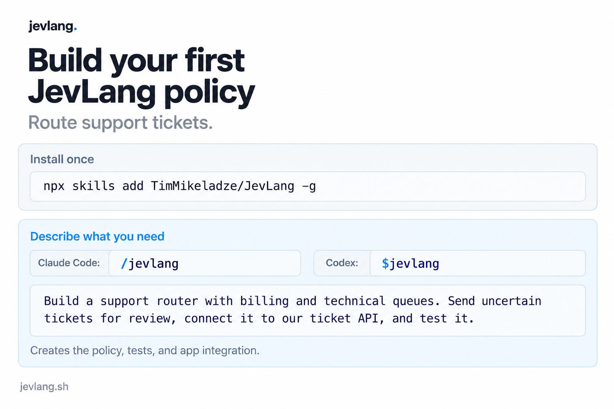

# Build your first JevLang policy

Route support tickets. Describe the behavior you need; get a policy, tests,
and the code connecting it to your app.

## Install once

```sh
npx skills add TimMikeladze/JevLang -g
```

Choose your agent when prompted. `-g` installs JevLang's coding skill across
your projects. Open a new agent session after installation.

## Describe what you need

In Claude Code:

```text
/jevlang Build a support router with billing and technical queues. Send uncertain tickets for review, connect it to our ticket API, and test it.
```

In Codex, start the same request with `$jevlang`.

The command uses your project's language, provider, and handlers. It tests with
supplied answers before trying live evaluation. Live model calls need your
provider's configuration; offline tests do not.

Use `/jevlang` for follow-up requests too: explain a decision, replay fixtures,
change a threshold, or connect an existing policy. A request to review or explain
stays read-only. An offline example stays offline.



## Install from this checkout

Run `npx skills add . -g` at the repository root. The GitHub install command
requires these files to be pushed to the existing repository first.

The [skills CLI](https://github.com/vercel-labs/skills) discovers the single
[`skills/jevlang`](../skills/jevlang) package. It contains its instructions,
references, and JavaScript/Python starters. Skill updates do not require an npm
release. The [skills.sh directory](https://skills.sh/docs) uses installation
activity; preparing the files does not publish a listing.

For maintenance, run `bun run test:skills` and `bun run test:skills:install`.
The latter installs into temporary projects for Claude Code and Codex, verifies
the packaged resources, and leaves global configuration untouched. `bun run
site` rebuilds the website and copies the [image](images/agent-skills.png), also
used in the social series. Its [prompt](images/agent-skills-prompt.md) records
the built-in image edit.
