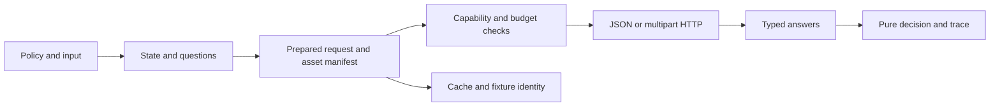

# JevLang support for Jev 1.14

Verified October 17, 2026. Status: JavaScript implementation built and verified; companion Python release and live model calibration remain separate work.

JevLang now requests `jev-1.14.0` by default and its pinned examples use that version. The implementation adds image assets, Box questions, explicit experimental headers, extended context, and updated transport and accounting contracts. Keep the engine dependency-free and retain pure offline decisions and replay.

## Release baseline and documentation

| Component | Verified target | Upgrade in this checkout |
| --- | --- | --- |
| Hosted Jev model | `jev-1.14.0`, released October 14 | Default in `src/client.js` and seven pinned examples updated |
| Model aliases | `jev-preview` → 1.14.0; `jev-latest` → 1.13.0 | Both remain explicit user choices |
| Official JavaScript SDK | `@typesafe-ai/sdk` 0.7.0 | Reference contract only; no installed SDK dependency |
| Official Python SDK | `typesafe-sdk` 0.7.5 | Reference contract only; Python implementation is outside this checkout |

Sources: [models](https://docs.typesafe.ai/models), [JavaScript changes](https://docs.typesafe.ai/sdk/javascript/changelog), [Python changes](https://docs.typesafe.ai/sdk/python/changelog). Alias targets are a dated observation, not a guarantee about their future values.

The canonical documentation is [docs.typesafe.ai](https://docs.typesafe.ai/), with a [machine-readable index](https://docs.typesafe.ai/llms.txt). The [research inventory](research/jev-latest.md) records the detailed upstream contracts and sources. Use the dedicated [images](https://docs.typesafe.ai/images) and [Box](https://docs.typesafe.ai/primitives/box) pages alongside the [HTTP reference](https://docs.typesafe.ai/api): the overview alone does not describe every new field.

The user authorized implementation after a second review. The [client guide](jev-images.md) describes the implemented API, and the [implementation plan](superpowers/plans/2026-10-17-jev-1.14.md) records the work sequence. Historical 1.13 fixtures and captured live output retain their actual provenance.

## Compatibility gaps reviewed before implementation

| Feature | Before implementation | Implemented result |
| --- | --- | --- |
| Text Choice, Score, Noul | Typed builders, validation, evaluation, decisions | Preserve their behavior and existing fixtures |
| Images in state, instructions and criteria | JSON copied without an asset contract; transport sends JSON only | Explicit assets survive construction, redaction, transport and replay |
| Box localization | Raw-question escape hatch only | Typed builder, validation, coordinates, confidence gates and traces |
| Extended context | Fixed local checks; no experimental headers | Independent request and question budgets, with explicit long-context opt-in |
| New client behavior | Fixed headers, no compression or cancellation option | Per-call controls, compression, model listing and accurate nullable usage |

These additions concern Jev's published capabilities and related SDK contracts. They do not introduce audio, video, generated prose, multiple boxes from one question, automatic image editing, or an invented image-token formula. TypeSafe's release announcement also describes console-based data-sharing opt-in; it does not document a request flag for JevLang to add. [Release announcement](https://typesafe.ai/blog/jev-1-14)

## Architecture and approach

Extend the current direct HTTP adapter. Adopting the official SDK would reduce transport work but add a runtime dependency and still leave policy validation, replay and provider selection unresolved. A raw-question-only integration would be smaller but would bypass the checks that distinguish JevLang. The proposed approach retains one portable policy model and adds a request-preparation boundary shared by the client, provider and CLI.



New `src/assets.js` owns portable image descriptors, reference discovery and manifests. New `src/typesafe-request.js` owns request preparation, body encoding, headers and compression. `src/client.js` keeps authentication, retries, cancellation, response parsing and model listing. Neither new module imports policy execution or dispatcher code.

## 1. Model versions and provider selection

The implemented low-level selection order remains call `model`, `clientSettings.defaultModel`, `TYPESAFE_DEFAULT_MODEL`, then pinned `jev-1.14.0`. Policy evaluation retains its existing policy and provider-configuration resolution before entering the client. An explicit 1.13 pin continues to work for its supported question kinds.

Add `listModels({ signal, timeoutSeconds, retry })` using authenticated `GET /v1/models`. Return the documented `models` array, including each entry's `name`, `description` and `release_date`; do not infer that omitted versioned IDs are invalid. Model discovery is explicit, never an extra request on every evaluation. [Model listing contract](https://docs.typesafe.ai/models#listing-models)

Request selection must include both modalities and question capabilities. Use the existing provider `controls` capability list for `box` and `typesafe-options`, preserving legacy text-only provider contracts. Prepared image requests require `image`; Box additionally requires `box` support. TypeSafe advertises the new capabilities only with the appropriate opt-in. Known model 1.13 rejects Box locally. Unknown model IDs can reach TypeSafe for authoritative validation; aliases are never permanently hardcoded as version equivalents.

Text-only Laya and existing text HTTP adapters must be ineligible for image and Box fallback. No adapter may serialize an image reference as ordinary prompt text while claiming image support. Third-party gateways require their own verified image protocol before advertising this capability.

## 2. Public options and portable assets

Implemented additions:

```ts
type ImageFormat = 'png' | 'jpg' | 'jpeg';
interface ImageAsset {
  type: 'image';
  format: ImageFormat;
  data_base64: string;
}
interface JevOptions {
  assets?: Record<string, ImageAsset>;
  experimental?: { images?: boolean; longContext?: boolean };
  compression?: 'auto' | 'zstd' | 'gzip' | false;
  assetTransport?: 'json' | 'multipart';
}
interface JevCallOptions extends JevOptions {
  model?: string | null;
  headers?: Record<string, string>;
  signal?: AbortSignal;
  timeoutSeconds?: number;
  retry?: Partial<RetryPolicy>;
}
```

Add `imageAsset(bytes, { format })` as an explicit bytes-to-JSON helper. File loading happens in caller code or the CLI, not as a side effect of `compile` or `decide`. Accept portable base64 asset maps at the public boundary; internally decode them once into reusable buffers for multipart. A later convenience wrapper can accept Blob inputs, but this release must not depend on SDK `Image` instances: the engine's `jsonCopy()` would erase runtime-only state.

Add optional `typesafe: JevOptions` to `PolicySpec`. It can carry static reference images and opt-ins, and is part of the immutable compiled artifact. Runtime `assets` add input images; collisions with static references reject instead of silently replacing a criterion's image. Per-call experimental booleans override policy defaults, including explicit `false`. Wire headers are generated from these effective booleans.

Forward these options explicitly through `evaluateWithProvider`, `evaluateConfiguredPolicy`, `runPolicyProvider`, `policyProviderRequest` and `typesafeProvider`. Runtime bytes stay separate from the generic provider prompt. Do not mutate global client settings for per-call data. Reject nonempty TypeSafe-specific options if an explicitly selected alternative provider cannot consume them.

### Image references and preprocessing

Support references as complete string values, inside sentences, and in nested arrays and objects across state, instructions and criteria. Match literal reference strings; leave object keys unchanged. Prefer UUID references. Preserve caller-supplied references when valid. Every supplied asset must be used by the final prepared request. [Image reference semantics](https://docs.typesafe.ai/images#references)

Resolve references after state whitelisting and family expansion. Treat state references as atomic segments during text redaction and capping: never redact part of an identifier or truncate base64. Question construction preserves JSON instructions and criteria without applying state text redactors. If a selected field or family item was removed, drop its now-unused derived asset; explicitly supplied unused assets produce a diagnostic naming the reference. Local-only fields never contribute uploads. An image's pixels are not redacted by JevLang's text redactors.

Keep generated references stable for a given prepared request and across retries. Cache identity uses content digests and canonicalized reference positions, so fresh UUIDs for identical images do not create different semantic requests.

### Validation and transport

Validate format, base64 syntax, decoded byte count, reference byte lengths and multipart relationships before fetch. Parse PNG/JPEG headers to check dimensions and reject APNG; malformed or unsupported encodings return field-specific errors. Do not resize, rotate or re-encode user images implicitly. Document explicit preprocessing for EXIF orientation and unsupported formats.

| Image constraint | Contract to enforce |
| --- | --- |
| Encodings | Still PNG or JPEG; decoded file ≤16 MiB |
| Geometry | Each dimension 280–1568; area 78,400–2,458,624 pixels |
| Reference sizes | Nonblank; each ≤1,024 UTF-8 bytes; combined ≤65,536 bytes |
| Request size | Body ≤32 MiB; compression does not increase the allowance |
| Server expansion | Processed unique images and expanded request each ≤32 MiB; repeated references count repeatedly |

The server's processed-image size cannot be predicted exactly from upload bytes. Local checks enforce measurable bounds and return server re-encoding failures unchanged. These are separate limits, not one total-upload counter. [Image limits](https://docs.typesafe.ai/images#limits)

Prefer multipart when assets exist: first part `request` with JSON content type, followed by uniquely named file parts referenced through `assets[reference].part`. Let FormData supply its boundary. Pure text stays JSON. Also support base64 JSON transport when multipart is unavailable. Recreate the encoded body for each retry from immutable prepared data. One part belongs to one asset; duplicate bytes can be uploaded once under a shared reference.

## 3. Box questions and decisions

Add a typed `box(id, instructions?)` builder, a `BoxQuestion` interface, and `BoxCoordinates` with `top`, `bottom`, `left`, `right`. Box has no criteria and returns one normalized rectangle. Require finite edges in [0,1], `left < right` and `top < bottom`; reject malformed answers before routes or handlers consume them. Add the Box branch to `questionsAnswerSchema` with required `type` and coordinates. [Box wire contract](https://docs.typesafe.ai/primitives/box)

Expose `value(): Expr<BoxCoordinates>`, edge accessors `top()`, `bottom()`, `left()`, `right()`, and `confidence(): Expr<number | null>`. Add `hasConfidence(): Expr<boolean>` to support explicit branches. Extend expression type checking, evaluation, reading logs, evidence, action params and explain output. A policy can use `value()` in `data` or a JSON action parameter without converting the rectangle to a score.

The dedicated Box page describes numeric confidence, while the [JavaScript BoxResponse](https://docs.typesafe.ai/sdk/javascript/api/interfaces/BoxResponse) permits null when unreported; the [Python response schema](https://docs.typesafe.ai/sdk/python/api/types/responses) also permits null. Normalize absent or null Box confidence to null, validate numeric values when present, and never invent a probability distribution. `confidence()` reports null; a configured confidence gate treats null as below threshold and runs its declared fallback. Gate metrics `topProb`, `margin` and option-specific gates remain invalid for Box. Clause checks require a base gate, an explicit confidence predicate, or an audited `ungated` reason when coordinates determine a branch.

Box never means “target exists.” Every localization example must pair a presence Noul with the Box and short-circuit on presence before using coordinates. Missing targets still yield a rectangle. Confidence alone does not replace a presence test. No automatic absent-target sentinel or empty rectangle is introduced.

Example using the implemented API:

```js
const present = noul('mug-present', 'Is there a coffee mug in `photo`?');
const mug = box('mug', 'The coffee mug in `photo`');
const policy = definePolicy({
  name: 'locate-mug', model: 'jev-1.14.0',
  typesafe: { experimental: { images: true } },
  questions: [present, mug],
  gates: [gate(mug, 0.8, escalate('review'), { onRead: true })],
  route: {
    clauses: [rule(present.yes(0.9), assign('found', { data: mug.value() }))],
    otherwise: hold({ reason: 'No reliable evidence of a mug' }),
  },
});
// input.photo holds a reference present in the separate assets map.
await evaluateWithProvider(policy, { photo: reference }, { assets });
```

The threshold is an application example, not a vendor-recommended calibration. Keep normalized coordinates in decisions. Pixel conversion belongs in the caller, with documented rounding and crop offsets.

## 4. Experimental flags and context budgets

Generate exactly `TypeSafe-Danger-Zone-Images: true` and `TypeSafe-Danger-Zone-Long-Context: true` for the respective effective opt-ins. Neither is enabled merely by upgrading the model. Images or Box without the image flag fail locally with the missing option named. Long context alone does not enable images. [Image opt-in](https://docs.typesafe.ai/images#turning-on-images), [context opt-in](https://docs.typesafe.ai/models#long-context)

Replace inconsistent local constants in `state.js`, `engine.js`, `evaluate.js` and `cost.js` with one model-limit table. Keep the documented default request/question limits of 64k/32k and opt-in long-context limits of 262k/262k distinct. Use decimal 64,000/32,000/262,000 as conservative local ceilings while upstream documents rounded “k” values. Enforce both the whole request and state plus each question, not just state plus the longest text string.

Separate caller budget from model capability. Existing `stateOptions.tokenLimit` remains an application limit; explicit null disables that local estimate but cannot grant extra upstream context. Add `stateOptions.requestTokenLimit` for the whole request. Explicit smaller limits always win. `buildState()` must not reject a policy's permitted long input at 32,768 before effective flags are available; prepared-request validation applies the final combined limits.

Text estimates retain their rough label. For images, report text estimates and unknown image-token contribution instead of counting base64 characters as model tokens. Use real `usage.input_tokens` for actual accounting. Do not claim exact preflight fit for image requests. Cost output and warnings must use the same effective flags and request that evaluation uses.

## 5. Client transport and usage

Extend the client without changing its seconds-based timeout API. Merge partial retry overrides over current defaults. Add per-call headers and an AbortSignal covering fetch, body reads, pacing and retry waits; explicit cancellation is nonretryable. Compose cancellation with per-attempt and total deadlines. Reject caller overrides of authorization, content framing, compression and generated experimental headers; credentials stay in client/environment settings. Header-name comparisons are case-insensitive. [Per-call SDK contract](https://docs.typesafe.ai/sdk/javascript/api/interfaces/RequestOptions)

Support `gzip` and `zstd`; `auto` chooses zstd for bodies ≥1 KiB when the runtime exposes it and otherwise sends uncompressed bytes. Explicit zstd on an unsupported runtime is a configuration error. Keep Node ≥22 support, including pre-22.15 runtimes. Compression uses one layer, zstd window ≤8 MiB, and validates compressed and decompressed body sizes. `compression:false` handles custom gateways. Do not silently retry a rejected compressed request as uncompressed. [Compression](https://docs.typesafe.ai/api#compression), [JavaScript runtime changes](https://docs.typesafe.ai/sdk/javascript/changelog)

Classify 413 as a nonretryable size error and 415 as a nonretryable encoding error. Preserve status, request ID and error body, including `max_tokens_exceeded`. Keep existing transient retry behavior for 408, 429 and 5xx, with Retry-After and total budget. Extend transport injection to receive an optional second argument containing effective headers, signal and prepared asset metadata; existing one-argument fakes continue to work.

Represent `input_tokens` and `output_tokens` as `number | null` when supplied, retaining unknown fields. Null means unreported, never a measured zero. Extend batch and pipeline reports with `usage_complete` and `unreported_calls`, keep known-token subtotals, and return null for total cost when required usage is unknown. Unknown calls must not train token fits or pacer averages as zero samples. Output tokens remain free; image tokens are included in input usage. No image-token estimator is currently published. [Usage fixes](https://docs.typesafe.ai/sdk/javascript/changelog), [image token accounting](https://docs.typesafe.ai/images#image-tokens)

## 6. Cache identity and replay

Version the answer cache key to include canonical state, questions, asset content digests, effective provider/model/effort, and experimental flags. Resolve effective provider configuration before computing this key: the current key uses unresolved nullable selection values. Changing the model default, a route-selected model, or image bytes must cause a miss. Changing only compression or transport part names must not. Moving aliases require bounded cache age or explicit invalidation; never claim that a historical alias cache entry represents today's model. Existing cache rows can expire normally and must not be silently rekeyed.

Add fixture version 4 for asset-aware runs, preserving version 3 text replay. Record the effective flags and an asset manifest containing digest, format, dimensions and reference placement. Never put credentials, filesystem paths, or arbitrary headers in fixtures. Embed image bytes only under an explicit recording option; otherwise store a caller-managed content-addressed reference. Do not fetch assets during replay.

Pure decision replay uses recorded answers and normalized state without image bytes. Report verification separately as `decisionVerified` and `assetsVerified`; a manifest without local bytes can verify decision behavior but cannot claim that the images were checked. Re-evaluation requires all image bytes and digest validation. Changing a static criterion image must mark a fixture stale even if question text and reference names are identical. Extend `identity()` and `fingerprint()` accordingly for image-bearing policies; retain existing text hashes.

Box readings preserve coordinates and nullable confidence. Include Box in confidence histograms only when numeric. Calibration requires explicit matching labels and a documented metric; do not treat a rectangle as a categorical answer or silently use Choice Brier calculations. An optional IoU report can compare labeled boxes separately without changing current calibration metrics.

## 7. CLI HTTP MCP and Python surfaces

Add `jev models`, `--assets manifest.json`, `--experimental-images`, `--experimental-long-context`, and `--compression` to evaluate, record and batch. A manifest can reference explicit files; resolve relative paths against the manifest location. Materialize assets once per row/request, enforce the same limits, and keep file reads out of policy construction. Existing text commands remain valid.

`serve` keeps JSON `/evaluate` input and adds an optional assets map. Effective experimental permissions are configured by the server operator; an incoming request cannot enable a disabled feature, supply upstream credentials, or override upstream headers. The default 1 MiB sidecar body cap remains independent of TypeSafe's limit; document an explicit `maxBody` setting up to 32 MiB for image workloads. Do not silently enlarge deployed servers' caps.

Update policy metadata and MCP schemas for Box, asset manifests and supported flags. Use JSON-safe image data for inbound tool arguments and preserve existing result shapes; do not advertise binary MCP upload support without implementing it. HTTP dispatch forwards its asset options to evaluation. Pipelines, sessions and webhook wiring continue taking application evaluate callbacks, which bind runtime assets explicitly; policy-owned static assets and flags propagate through evaluation. The dispatcher still receives only validated decisions.

The native Python companion is implemented locally in sibling `../jev-lang/packages/jevlang-python` on branch `feat/jev-1.14-python-parity`. It supports the portable image fields, Box expressions/gates, nullable confidence, v4 fixtures, async native HTTP, compression, context options, caching and server surfaces. Both engines consume the same checked-in golden cases for manifests, complete decisions, Unicode content identity and cache keys. The Python `JEV114.md` records runtime boundaries: Python 3.9+, no mandatory runtime dependencies, standard-library zstd when available, and no Node at runtime. SDK-specific HTTP/2 and Pydantic models remain optional adapter conveniences. Neither companion change has been published.

## Implementation sequence

1. **Request boundary — 2–3 engineering days.** Add assets, immutable preparation, per-call options, multipart and limits. Prove text payload compatibility and retry body stability before routing image requests.
2. **Box language — 2–3 days.** Extend builders, schema, expressions, gates, traces and declarations. Prove presence-first behavior and null-confidence fallback offline.
3. **Transport and budgets — 2–3 days.** Add independent context checks, opt-in headers, cancellation, compression, model listing and nullable accounting.
4. **Persistence and integrations — 3–4 days.** Version cache identity and fixtures, then thread options through CLI, serve, MCP and automation. Coordinate Python parity separately.
5. **Release validation — 1–2 days.** Add examples and documentation, run offline acceptance suites, then execute opt-in live checks with labeled images and compare model outcomes.

Estimate: 10–15 engineering days for this JavaScript checkout, plus 3–5 days for the companion Python implementation if its current interfaces match the handoff. These are implementation estimates, not measured performance claims.

### Files and responsibilities

| Area | Primary files |
| --- | --- |
| Assets and HTTP preparation | New `src/assets.js`, `src/typesafe-request.js`; `src/client.js` |
| Portable language and types | `src/index.js`, `src/index.d.ts`, `src/validate.js`, `src/engine.js`, `src/expressions.js` |
| Providers and budgets | `src/evaluate.js`, `src/state.js`, `src/cost.js`, `src/provider/core.js`, `src/provider/route.js`, `src/provider/index.d.ts` |
| Persistence and accounting | `src/fixtures.js`, `src/store.js`, `src/monitor.js`, `src/explain.js`, `src/batch.js`, `src/pipeline.js` |
| Product surfaces | `src/cli.js`, `src/serve.js`, `src/mcp.js`, `src/dispatch.js`, `src/session.js`, `src/wiring.js`, associated declarations and examples |

## Acceptance tests and release criteria

### Assets and HTTP

1. Local HTTP tests assert exact experimental headers, JSON/base64 and multipart semantics, content types, byte limits, replayable retry bodies, and case-insensitive protected headers.
2. Reference tests cover full values, substrings, nested criteria, families, object keys, unused assets, Unicode byte limits, redaction, caps and local-only fields.
3. Image tests cover both format aliases, minimum/maximum geometry, APNG, invalid base64, corrupt headers, duplicate parts and repeated references; no test downloads an image.
4. Cancellation tests abort before fetch, during body consumption and during retry waits, proving no subsequent request starts. Compression tests decompress the body and verify boundaries, thresholds and fallback behavior.
5. Model tests cover 1.14 defaults, explicit 1.13, aliases, model listing, unknown version IDs and refusal of text-only providers for image/Box requests.

### Language persistence and integrations

1. Box tests reject invalid edges and metrics, preserve null confidence, trigger gate fallback, and prove an absent-target Noul prevents coordinate use. Type tests reject Box score/choice accessors.
2. Budget tests cover default and opt-in request/question boundaries, smaller caller limits, initial state building and unknown image tokens. Nullable usage tests distinguish zero usage from incomplete totals.
3. Cache tests distinguish image changes, effective model/config changes and experimental flags, while deduplicating transport-only changes and concurrent identical calls.
4. Fixture tests preserve version 3 text replay, verify version 4 asset digests and staleness, and replay without network or bytes while accurately reporting verification scope.
5. CLI, sidecar, MCP and dispatch tests exercise the same prepared image policy, operator-controlled flags and body caps. Shared fixtures prove Python parity before cross-language support is advertised.

Run `bun run test` and `bun run test:types` for every implementation phase. Run site tests after generating assets in a separate prepared checkout when existing generated files have been intentionally removed. Live model tests are opt-in and require separate image labels; mocked transport success cannot establish model quality or threshold calibration.

## Implementation verification

| Check | Result |
| --- | --- |
| Package suite `bun run test` | 200 passed, 7 Redis tests skipped, 0 failed |
| New Jev tests under Node | 38 passed, 0 failed |
| `bun run test:types` | Passed |
| Docs site build and tests | Build succeeded; 17 tests passed in a scratch checkout |
| Package build `npm pack --dry-run --json` | 69 files, including the new runtime modules and declarations |

The site check used unchanged Open Graph card fixtures from git in the scratch checkout; preexisting `site/out` deletions in the working checkout remain intact. The package has no transpilation step: its published exports are source JavaScript and declarations. No package was published and no authenticated model call was used to infer image accuracy.

## Second review implementation decisions

The second pass found the preexisting 2 MiB JSON copy limit unsuitable for images. Ordinary JSON retains that bound; asset-aware portable artifacts have a separate 48 MiB allowance for base64 expansion, while the actual HTTP body remains capped at 32 MiB. This allows valid multipart uploads whose base64 representation exceeds the wire limit.

Canonical cache identity uses typed JSON/text/image segments so caller text cannot impersonate an image digest. Moving aliases have a 300-second default cache age. Offline cache reads skip discovery. Completed fallback answers are discarded from the primary target's key.

Fixture verification checks manifest structure and image digests separately from question identity. Embedded copies of static policy assets are allowed only when their hashes match. File parsing verifies structural PNG/JPEG headers, including JPEG scan/end markers; full pixel decoding remains authoritative at the service.

The separate Python release, optional IoU reporting and opt-in live calibration are outside this checkout's implementation. The current JavaScript release does not claim Python parity for new fields or measured model quality from offline tests.
